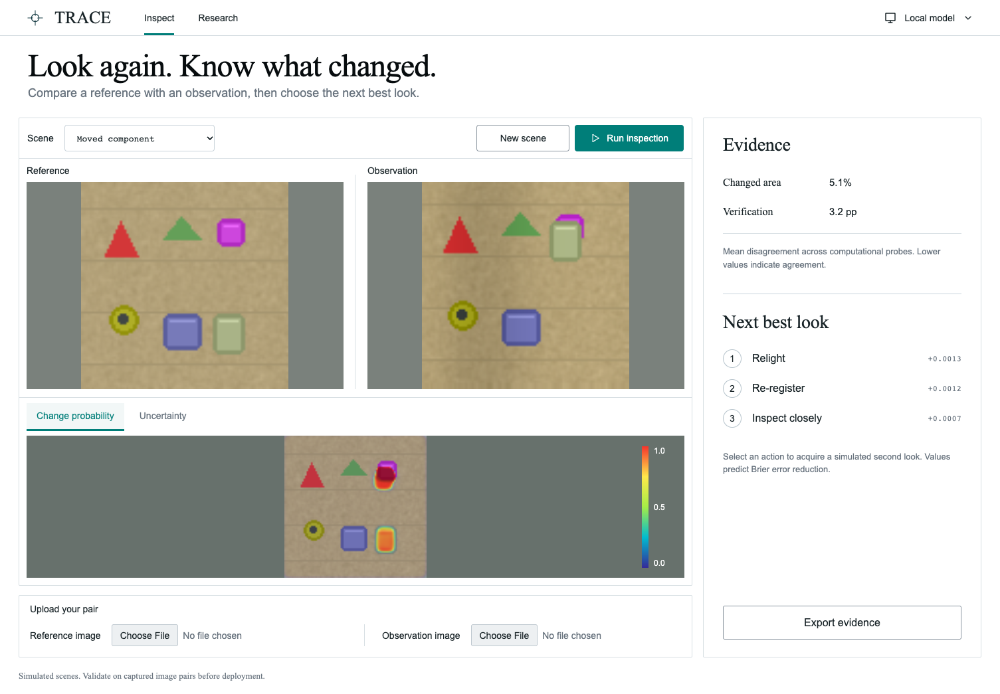

# TRACE

**Tested Re-observation and Acquisition-aware Change Evidence**

[](https://github.com/tarang-tj/trace/actions/workflows/check.yml)
[](https://github.com/tarang-tj/trace/releases)
[](LICENSE)

An end-to-end computer-vision research project by **Tarang Jammalamadaka**, asking two questions:
what physically changed, and which second look would help verify it?

TRACE learns pixelwise evidence and trust across four computational probes—observed, relit,
registered, and combined—then predicts a change map, a learned error indicator, and the measured
value of another observation. This release includes the model implementation, procedural scene
simulator, training and evaluation pipeline, ablations, calibration, follow-up policy, local API,
batch CLI, interactive React studio, and archived research evidence.

The research hypothesis is the combined intervention-survival and follow-up learning loop.
Global novelty is unproven. Computational corrections do not establish causality, and the action
policy has only simulator evidence. This is a completed research artifact, with unresolved
experimental findings and no field validation.



## Measured results

These are the archived ten-epoch, single-seed experiments; newly trained models may differ.

| Held-out evaluation | TRACE | Raw detector | Corrected detector |
|---|---:|---:|---:|
| Mixed procedural scenes, 128 scenes, F1 | 0.909 | 0.805 | 0.892 |
| Real PCD images, 20 panoramas / 80 crops, F1 | 0.763 | 0.728 | 0.756 |

Real-image TRACE F1 has a panorama-bootstrap 95% interval of **[0.703, 0.810]**. Its paired
advantage over the corrected detector is unresolved: **[-0.006, 0.018]**. TRACE's real-image
false-positive rate is **15.443%**. Under stronger unseen nuisance, TRACE scores 0.591 F1 versus
0.619 for the corrected detector. The learned follow-up policy harms **40/128 scenes (31.25%)**
and has no demonstrated advantage over fixed or heuristic action selection.

Read the [model card](docs/model-card.md), [dataset protocol](docs/dataset-card.md),
[technical note](docs/technical-note.md), and [research positioning](docs/research.md) for the
full comparisons, uncertainty, failure modes, and provenance limits. Plots and their source
tables are in [docs/figures](docs/figures/captions.md).

## Ownership and release contents

**Copyright © 2026 Tarang Jammalamadaka. All rights reserved.** The original project is publicly
viewable under the [LICENSE](LICENSE); it is not released under an open-source reuse license.
GitHub's platform terms permit public viewing and forking. Other reuse requires applicable legal
permission or written authorization. Contact the owner through [GitHub](https://github.com/tarang-tj).
The commands below document reproduction for the owner and authorized users.

The repository and release contain source, documentation, procedural example images, experiment
statistics, split IDs, checksums, figures, and browser evidence. **Raw PCD photographs, masks,
and PCD-trained detector/policy checkpoints are not distributed.** Third-party dependencies and
research data retain their owners' rights; see [THIRD_PARTY_NOTICES.md](THIRD_PARTY_NOTICES.md).
A fresh checkout needs training before inference can run.

## Install and run

Use Python **3.12** and Node.js **22**. Install from the repository so the Python service can
find the studio and research reports. No API keys or cloud services are needed.

```bash
git clone https://github.com/tarang-tj/trace.git
cd trace
python3.12 -m venv .venv
source .venv/bin/activate
python -m pip install -e '.[dev,research]'
cd web
npm ci
npm run build
cd ..

# Train all three detectors and the policy, then evaluate using original procedural data only.
python scripts/reproduce.py --synthetic-only
tracecv serve --model artifacts/trace --port 8765
```

On Windows, activate with `.venv\Scripts\Activate.ps1` instead. Open **http://127.0.0.1:8765**.
Inspect a scene, switch probability/error maps, request an actual simulated follow-up, upload a
matched image pair, or export evidence. The Research page reads the reports present in the checkout;
Local model shows the loaded checkpoint identity. Uploads are processed locally without retention.
The research model resizes inputs to **96 × 96**.

The procedural reproduction is a separate experiment from the archived mixed-data results.
Reproduction **overwrites local reports and figures when applicable**; use a separate checkout
to preserve the published evidence. Training chooses CUDA, Apple MPS, or CPU. Inference and
evaluation default to CPU. The reference run used Python 3.12.7 and Apple MPS; recorded core
versions are in [requirements-research.txt](requirements-research.txt). Platform and package
differences can change floating-point results.

### Reproduce the mixed-data research protocol

First review the [PCD authors' research-use terms](https://sakuradaken.net/pcd_dataset.html) and
the [dataset card](docs/dataset-card.md). In a separate authorized checkout with the environment
installed, run:

```bash
python scripts/reproduce.py
tracecv serve --model artifacts/trace --port 8765
```

This downloads the authors' TSUNAMI archive, trains TRACE and two ablations for ten epochs,
trains the follow-up policy, evaluates all detectors, audits policy outcomes, and renders figures.
The custom split assigns whole panoramas before cropping; geographic separation is unverified.
Validation data alone selects calibrators, thresholds, and the fixed-action baseline.

`--skip-trained` explicitly reuses completed detector runs, while rebuilding policy and evaluation.
Seeds, splits, runtime versions, hashes, and source manifests are retained in the artifacts.
Initial experiments recorded source files at completion; the corrected baseline also preserves
its executed trainer. Future training snapshots sources at startup. This provenance limitation
and the absence of repeated training seeds are documented in the model card.

## Inspect pairs and batches

After training and activating the environment:

```bash
tracecv inspect examples/moved-reference.png examples/moved-observation.png --output artifacts/example/evidence.json
tracecv batch examples/pairs.csv --output artifacts/batch
```

Single-pair inspection writes evidence JSON and float NPZ maps with probabilities, error scores,
binary masks, branch probabilities, and trust weights. Batch inspection writes per-pair JSON
and a summary CSV. Its manifest uses unique IDs containing letters, digits, underscores, or
hyphens, with image paths relative to the manifest:

```csv
id,reference,observation
surface01,images/before.png,images/after.png
```

Region boxes refer to the resized image. Inputs must have matching dimensions, at least
32 pixels per side, and at most 16 million pixels; API uploads are limited to 10 MB per image.
Physical camera control is not implemented. Uploaded-image follow-up recommendations are
simulator-trained advice for an operator to test. The local API documentation is at
**http://127.0.0.1:8765/docs**; health, scene, inspection, and research endpoints use `/api/`.

## Verification

```bash
python -m pytest -q
ruff check src scripts tests --select F,I,E9
cd web
npm run build
npx playwright install chromium
TRACE_EXPECT_RESEARCH=1 node qa.mjs
```

Run browser QA while the server is running. An installed compatible browser can be selected
with `TRACE_BROWSER_EXECUTABLE`. The QA checks inspection, tabs, export, actual simulated
follow-up, uploads, research tables, checkpoint identity, desktop copy/layout, and mobile overflow.
[Studio verification](docs/studio-verification.md) preserves the original frozen-model review.

[GitHub Actions](https://github.com/tarang-tj/trace/actions/workflows/check.yml) starts from a
fresh checkout, trains a small **procedural-only smoke model and policy**, runs Python checks,
builds the frontend, and exercises the application in Chromium. Smoke training verifies the
workflow and interfaces; it does not reproduce or validate the published research scores.
The data-dependent contract skips when PCD is absent. Local tests also exercise the original
trained checkpoint when available.

After a full ten-epoch mixed-data reproduction and browser QA, the optional frozen-artifact
verifier checks checkpoint/report identities, panorama splits, cached policy measurements,
figure layout audits, and browser evidence:

```bash
python scripts/verify_artifacts.py
```

It requires locally available research checkpoints and matching browser evidence; it is
not a source-only or smoke-model check. The archived verification is in
[artifacts/verification.json](artifacts/verification.json).

## Project map

| Path | Responsibility |
|---|---|
| `src/tracecv/simulator.py` | Deterministic rendering, nuisance, independent sensor interventions |
| `src/tracecv/interventions.py`, `model.py` | Label-free probes, shared pyramid, learned trust pooling and error head |
| `src/tracecv/train.py`, `metrics.py` | Detector training, validation selection, calibration |
| `src/tracecv/policy.py`, `evaluate.py` | Follow-up value learning and held-out comparisons |
| `src/tracecv/inference.py`, `api.py`, `cli.py` | Inference, local service, batch export |
| `web/` | React studio, research presentation, browser verification |
| `scripts/` | Dataset fetch, reproduction, policy audit, figures |
| `artifacts/` | Published reports, manifests, numeric measurements, QA evidence; local weights excluded |
| `examples/` | Original procedural pairs, labels, and batch manifest |
| `docs/` | Architecture, technical note, research cards, figures, design verification |

See [architecture](docs/architecture.md) for runtime limits and [CHANGELOG.md](CHANGELOG.md)
for the release record. Small defects, unfamiliar materials, nonrigid/projective camera motion,
geographic overlap, physical follow-up value, and real acquisition costs remain open problems.
The location-separated physical capture study described in the dataset card has not been run.

Citation metadata is provided in [CITATION.cff](CITATION.cff); attribution does not grant reuse rights.
