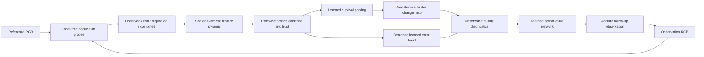

# TRACE: intervention survival and re-observation value

The system separates a physical scene from how a sensor acquires it. The detector receives
only two RGB images. It never receives simulator state, sensor settings, or ground truth.

## What is learned

One shared three-scale encoder processes each reference/query branch. At each scale, concatenated
reference features, query features, and absolute differences pass through a fusion block. A decoder
predicts an evidence logit and a trust logit for every pixel. Softmax trust weights pool branch evidence.
Weighted, mean, minimum, maximum, and variance statistics feed a learned residual pooling network.
The resulting logit is trained with BCE, Dice, and branch auxiliary losses.

A separate error head predicts disagreement between the segmentation decision and its training label.
Its inputs are detached: the detector cannot improve this loss by making segmentation easier to explain.
Validation temperature fitting reduces NLL; a validation-only F1 sweep selects the decision threshold.
The error head's temperature is fitted separately. Its outputs are indicators, not guarantees of safety
or calibrated out-of-domain reliability. Threshold changes create a train/calibration mismatch in error
targets; the selective-risk evaluation measures the practical consequence.

## What the probes mean

The four vertices apply two transformations independently and together: channelwise robust quantile
photometric alignment, and gradient-based translation registration within ±4 pixels. These probes
can remove real changes or preserve nuisances. Their logits are evidence the model must learn to
interpret; agreement does not prove causality. A single globally corrected branch is an explicit
ablation, because learned pooling is unnecessary if correction alone works equally well.

## The planner is trained on interventions

For a new simulator scene, compute initial Brier error and the error after independently resetting
lighting, translation, or focus/noise. Use the same valid pixels before and after. Their differences
are supervised action-value targets, including negative values. A small MLP sees twelve observable
diagnostics, standardized with training statistics. Its inputs include image residuals, estimated
translation, sharpness, probability distribution summaries, learned error, branch disagreement,
and trust entropy. It never sees latent sensor settings or the labels used to compute targets.

Detector training/validation/test seeds start at 0/1M/2M, OOD at 3M; planner training/validation/test
start at 4M/5M/6M. Each entire scene belongs to one split. A frozen detector checksum binds the
planner to the model that generated its targets. Deployment ranks actions by predicted Brier reduction.
Simulator actions independently start from the original acquisition; they do not compose cumulatively.
For uploaded images, recommendations are simulator-derived advice for an operator, not a physical
camera command. The studio cannot manufacture a new real sensor observation.

## Runtime contract

The initial release resizes equally sized uploaded images to 96 × 96, the trained resolution. This
can distort aspect ratios and discard small defects; exported evidence records processing size and
original dimensions. The model is fully convolutional, but higher-resolution calibration has not been
validated. Five boundary pixels are excluded from changed-area reporting. Training/evaluation use
additional known simulation sensor borders only for loss/scoring, never for planner features.

FastAPI serves the local studio and checkpoint-backed inference. It limits encoded uploads to 10 MB
per image and decoded images to 16 million pixels. TRACE does not save uploads; the framework can
spool larger multipart bodies to temporary files during a request. Inference is serialized per
process, and async uploads dispatch the CPU work to a thread. A missing checkpoint returns 503;
there is no fallback to random weights. Exports contain a model hash, calibrated threshold, region
boxes in processing coordinates, quantized probability/error maps, branch statistics, and limitations.
Training logs and manifests record artifact hashes and source manifests. Initial runs recorded
files at completion; the corrected baseline preserves its executed trainer because materialization
was optimized while it ran. New runs snapshot all Python source at startup. The model card describes
the limits of the initial manifests.

## Expansion path

The first meaningful field experiment is a fixed-camera capture protocol with independently recorded
lighting, pose, and blur perturbations, paired pixel annotations, and scene/location separation. Then
extend registration to projective/dense warps, add overlapping high-resolution tiles with a separately
validated calibration, and learn hardware action costs. These require fresh experiments; shipping
an adapter without captured evidence would not establish the technology's physical validity.
