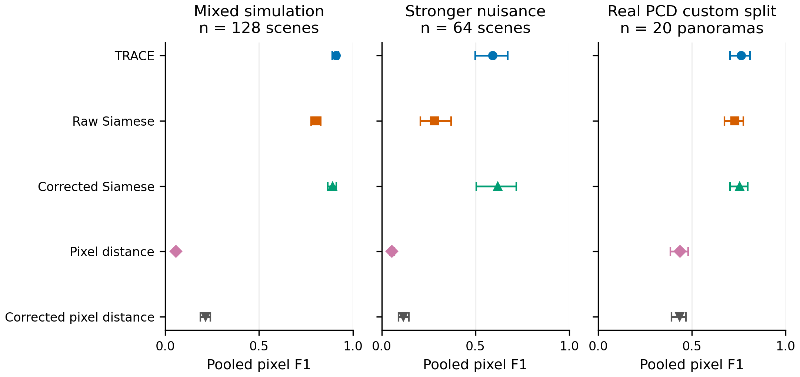
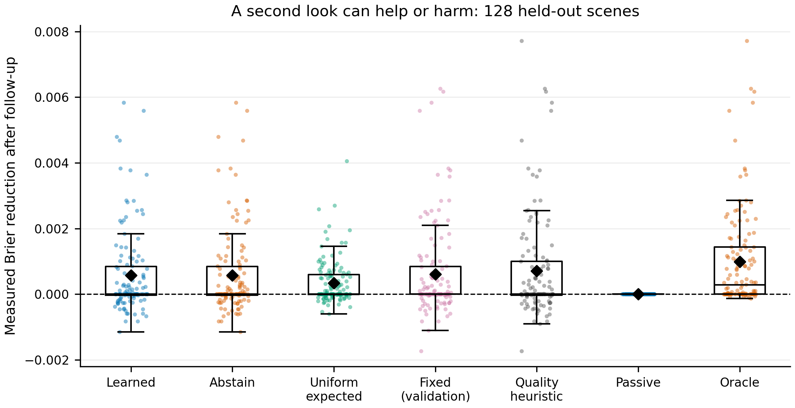

# TRACE model card and frozen results

TRACE is a working research prototype of acquisition-aware change detection and follow-up value
learning. The experiment supports a benefit over the raw Siamese baseline. It does **not** establish
a real-image advantage over the simpler corrected Siamese model, or a policy advantage over fixed
registration and a quality heuristic. Global novelty, field reliability, and state-of-the-art
performance remain unproven.

Use TRACE to explore the intervention-survival hypothesis and inspect its evidence. For a first
physical capture study, retain the corrected baseline and quality heuristic as required comparators.
Their simpler decision rules are the practical starting point; this run does not justify replacing
them with learned pooling and action selection for an operational system.

## Artifact and training

The detector takes two RGB images and produces pixel change probabilities, a binary mask, a learned
error indicator, branch evidence/trust, observable diagnostics, and simulator-trained action values.
The local CLI/API process images at 96 × 96. Regions use processing-image coordinates. This resolution
can discard small defects and distort non-square uploads; higher-resolution inference has not been
validated.

The shared encoder has three scales (12/24/48 channels). TRACE pools four label-free computational
probes with learned pixelwise trust and a residual statistic network; it has 176,704 parameters.
The raw and corrected models share the Siamese architecture and objective, using the observed or
combined-correction branch respectively. TRACE evaluates more branches; this is **not** an equal
compute ablation. A complete factorial study of pooling, auxiliary loss, and error features is absent.

All three variants trained for ten epochs with seed 42, AdamW, batch size 8, learning rate 0.002,
and 752 examples: 512 procedural scenes plus 240 crops from 60 real panoramas. Checkpoint selection
uses 176 validation examples: 96 procedural scenes plus 80 crops from 20 validation panoramas.
Temperature, segmentation threshold, and error-head temperature use validation only. Test scenes
and panoramas were not used for selection. Best epochs were TRACE 9, raw 7, corrected 9.

| Variant | Temperature | Threshold | Validation F1 | Calibrated validation Brier |
|---|---:|---:|---:|---:|
| TRACE | 1.7347 | 0.525 | 0.7754 | 0.05817 |
| Raw Siamese | 1.5426 | 0.425 | 0.7451 | 0.06414 |
| Corrected Siamese | 1.4869 | 0.475 | 0.7727 | 0.05763 |

Full checkpoint identities are in [the evaluation report](../artifacts/evaluation/report.json) and
each training provenance manifest. TRACE's SHA-256 is
`876e12fcbeeae681ad8a48f79ee8cf9ccdc30877411c51bd0074cbd4a0946707`.
The policy is bound to this exact checkpoint and feature schema.

## Evaluation protocol

The frozen evaluation contains 128 mixed procedural scenes (seeds 2,000,000 onward), 64 scenes
with doubled nuisance severity (3,000,000 onward), 32 unchanged scenes for each of lighting,
camera translation, and blur (2,100,000 / 2,200,000 / 2,300,000 onward), and 20 held-out PCD TSUNAMI
panoramas. Each panorama supplies four horizontal crops resized to 96 × 96. The real split is
60/20/20 whole panoramas, using RNG 731 before cropping. Geographic overlap between panoramas is
unverified. See [the dataset card](dataset-card.md) for masks, valid borders, terms, and limitations.

F1 and IoU pool valid-pixel confusion counts. Brier is mean squared probability error; lower is
better. ECE uses ten equal-width probability bins. FPR is the fraction of truly unchanged valid
pixels predicted changed. Five boundary pixels are excluded; simulation also excludes known
unobserved sensor borders. These scoring masks are not model inputs.

Intervals below are 95% percentile intervals from 1,000 test-sample bootstrap replicates. The real
bootstrap resamples whole panoramas, grouping all four crops. Paired differences reuse the same
resampled units. These exploratory intervals do not account for training randomness, geographic
correlation, or multiple comparisons. There is only one training seed. Stronger-nuisance scenes
remain in the renderer family and are not a new object or material domain.

## Frozen detector results

Each entry is pooled F1 [95% interval]. The two pixel-distance models are minimal sanity baselines,
calibrated on the same validation data; they are not a comprehensive comparison with modern methods.

| Model | Mixed simulation, n=128 | Stronger nuisance, n=64 | Real panoramas, n=20 |
|---|---:|---:|---:|
| TRACE | 0.909 [0.891, 0.924] | 0.591 [0.499, 0.672] | 0.763 [0.703, 0.810] |
| Raw Siamese | 0.805 [0.777, 0.830] | 0.281 [0.207, 0.369] | 0.728 [0.674, 0.775] |
| Corrected Siamese | 0.892 [0.867, 0.913] | 0.619 [0.504, 0.718] | 0.756 [0.704, 0.799] |
| Pixel distance | 0.057 [0.050, 0.065] | 0.055 [0.043, 0.067] | 0.436 [0.386, 0.481] |
| Corrected pixel distance | 0.215 [0.187, 0.241] | 0.116 [0.089, 0.145] | 0.436 [0.392, 0.470] |

| Paired TRACE minus baseline F1 | Mixed interval | Stronger-nuisance interval | Real interval |
|---|---:|---:|---:|
| Raw Siamese | [0.0854, 0.1237] | [0.2478, 0.3595] | [0.0069, 0.0626] |
| Corrected Siamese | [0.0048, 0.0323] | [-0.0925, 0.0363] | [-0.0064, 0.0176] |

The measured pooling advantage over correction alone is supported in mixed simulation. Its real
difference is only 0.0070 F1 with an interval crossing zero. The corrected model leads under stronger
nuisance by point estimate, also with an unresolved paired difference. Domain-independent superiority
is not supported.

| TRACE suite | IoU | Brier | ECE | FPR |
|---|---:|---:|---:|---:|
| Mixed simulation | 0.8336 | 0.00382 | 0.00116 | 0.188% |
| Stronger nuisance | 0.4192 | 0.02411 | 0.03285 | 2.711% |
| Real PCD custom split | 0.6166 | 0.10820 | 0.04630 | 15.443% |

The real-image false positive rate is substantial. On the same split the raw and corrected models
have 18.628% and 17.075% FPR. Good simulation scores should not be interpreted as evidence of low
false alarms on captured industrial images.

The unchanged controls have no positive labels, so F1 is uninformative and reported as zero by the
metric convention. Their observed FPRs are:

| Model | Lighting only, n=32 | Camera only, n=32 | Blur only, n=32 |
|---|---:|---:|---:|
| TRACE | 0% | 0% | 0% |
| Raw Siamese | 0% | 0.01274% | 0% |
| Corrected Siamese | 0.00296% | 0% | 0% |

Zero observed false positives on these finite controls is not a population guarantee.

## Learned error indicator

The detached head learns segmentation mistakes at the training decision rule. Its temperature is
fitted against validation mistakes after segmentation calibration. This creates a target mismatch;
the output is a learned indicator, not a promised probability of failure under arbitrary domain shift.

| TRACE suite | Error-head Brier | Error-head ECE | Observed pixel error rate |
|---|---:|---:|---:|
| Mixed simulation | 0.00383 | 0.00030 | 0.469% |
| Stronger nuisance | 0.02473 | 0.00227 | 3.124% |
| Real custom split | 0.10767 | 0.02632 | 15.223% |

Selective risk retains the lowest-indicator pixels. On real data:

| Retained pixel coverage | Learned-error ranking | Probability-entropy ranking | Random expected |
|---|---:|---:|---:|
| 100% | 15.223% | 15.223% | 15.223% |
| 75% | 7.688% | 8.021% | 15.223% |
| 50% | 2.616% | 2.772% | 15.223% |
| 25% | 0.485% | 0.699% | 15.223% |

Both rankings concentrate mistakes in rejected pixels. The modest difference between rankings lacks
a confidence interval and should not be claimed as established superiority. Selective risk measures
pixel decisions after rejection, not scene safety or calibration of a whole inspection.

## Follow-up policy

The policy trained for 250 epochs on 256 detector-disjoint scenes (4M seeds), selected its checkpoint
on 64 validation scenes (5M), and was tested on 128 independent scenes (6M). Twelve observable features
predict the Brier reduction after three actual, independent sensor re-observations: relight,
re-register, and focus/noise reset. Each action starts from the original acquisition. Ground truth
constructs value targets and test scores but is unavailable to policy inputs.

All gains compare identical valid pixels before and after acquisition. The validation-selected fixed
action is re-registration. The predeclared heuristic chooses registration for estimated L1 shift ≥2,
otherwise relighting for raw-minus-relit residual >0.02, otherwise focus. Uniform random is evaluated
by its exact per-scene expected value. Positive reduction is beneficial.

| Strategy | Mean test Brier reduction |
|---|---:|
| Learned | 0.000568565 |
| Learned with nonpositive-value abstention | 0.000568565 |
| Uniform random, expected | 0.000340197 |
| Fixed registration, selected on validation | 0.000610303 |
| Image-quality heuristic | 0.000712257 |
| Passive | 0 |
| Oracle among three actions | 0.000991769 |

| Paired learned minus comparator | 95% bootstrap interval |
|---|---:|
| Uniform random | [0.0000916, 0.0003936] |
| Passive | [0.0003822, 0.0007963] |
| Fixed registration | [-0.0001985, 0.0001171] |
| Image-quality heuristic | [-0.0003285, 0.0000276] |

The learned choice harmed **40/128 scenes (31.25%)**, had 42.97% top-action accuracy, and oracle regret
0.000423204. It chose relight 34 times, registration 69, and focus 25. Predicted-value RMSE was
0.00112422. Abstention occurred once (0.78125%) and left mean value essentially unchanged; this rule
does not resolve the observed harmful-action rate. Oracle uses labels and is unattainable at inference;
allowing the oracle to remain passive raises its mean to 0.000995994.

Average gain over random/passive is supported in this simulator experiment. An advantage over the
simpler policies is not established. The heuristic has the highest attainable point estimate here.
Action costs, cumulative action sequences, new materials, and physical camera control were not
studied. Uploaded-image recommendations require a new operator capture; the software cannot create
a real sensor observation.

The frozen audit reproduced the original learned mean exactly without retraining. Cached features,
measured gains, predictions, policy/checkpoint hashes, validation-only fixed selection, and intervals
are in [the policy report](../artifacts/trace/policy-report.json). The original training report is retained.

## Runtime and reproducibility

Local training used Apple MPS on an Apple M3 with 16 GiB RAM, Python 3.12.7, PyTorch 2.13.0, NumPy
1.26.4. Evaluation used CPU with four PyTorch threads. Measured TRACE predict-call p50/p95 latency
was 295/924 ms on mixed scenes, 228/640 ms on stronger nuisance, and 101/212 ms on real crops.
These include probe construction and result preparation, exclude image decoding and HTTP/PNG
serialization, and come from a shared workstation under variable background load. They are not
controlled throughput benchmarks or device-independent latency promises.

The [README](../README.md) supplies installation, reproduction, CLI, API, and checks. Raw data and
checkpoint binaries remain local ignored artifacts; a fresh checkout must download permitted
research data and train. Exact core package pins, panorama IDs, seeds, ten-epoch histories, validation
calibrators, hashes, per-scene confusion counts, and policy test arrays are retained. The research
figures have CSV source data, editable SVGs, 300-DPI PNGs, captions, data profiles, and layout audits.
Single-seed histories appear in [the learning figure](figures/learning.png).

The initial source manifests recorded files on disk at training completion, rather than archiving
every loaded module at startup. Thus they are not a complete byte-for-byte execution snapshot. The
corrected run preserves its executed trainer in `artifacts/combined/training-source/train.py`;
subsequent materialization changes reduce memory use. An exact comparison on two procedural examples
confirmed unchanged baseline inputs and logits. Future training snapshots every Python source file
at run start and writes checkpoints/JSON atomically. Cross-device bit-exact training reproduction
has not been established.

## Limits and the experiment that matters next

The assumption most likely to fail is that simple image corrections and simulator acquisition resets
represent real nuisance without removing meaningful physical changes. Translation-only registration
cannot handle projective/nonrigid motion; photometric correction can erase true appearance changes.
Small defects, unfamiliar materials, sensor artifacts, nearby real panoramas, and inaccurate labels
can invalidate the evidence and error indicator. Computational agreement does not establish causality.

A location-separated capture study with labeled physical changes, unchanged controls, repeated
lighting/pose/focus states, and measured acquisition costs would change the recommendation. Learned
pooling and action selection should beat the corrected detector and quality heuristic across
locations, seeds, and action budgets before claiming field value. The [specified capture protocol](dataset-card.md)
has not been performed. Existing change-detection and active-inspection work is acknowledged in
[research positioning](research.md); originality of this implementation does not prove worldwide novelty.

Original source and project materials are published with all rights reserved by Tarang Jammalamadaka;
see [LICENSE](../LICENSE). PCD remains copyrighted research data; the project notice grants no
dataset or learned-checkpoint rights. The mixed-data model remains a local research artifact and
is not distributed in this release. See [third-party notices](../THIRD_PARTY_NOTICES.md).
